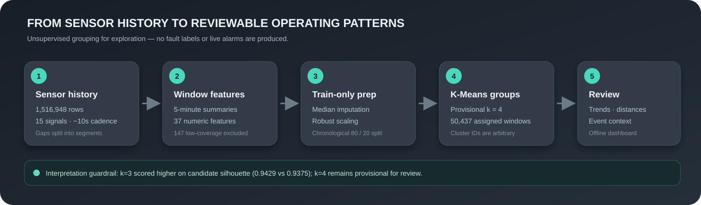

# Compressor Operating-Behavior Model

  
  
  

> **Interpretation:** this is an unsupervised model of operating behavior. Cluster labels are not health grades or fault labels. It does not predict failures.

## At a glance

| Item | Current saved configuration |
|---|---|
| Algorithm | K-Means with k-means++ initialization |
| Provisional cluster count | k=4 |
| Input | 37 numeric summaries from non-overlapping five-minute windows |
| Eligible windows | 50,437 of 50,584; 147 below the 80% coverage threshold were not assigned |
| Time split | First 80% chronologically for training; latest 20% as holdout |
| Preprocessing | Median imputation and robust scaling, fitted on training data only |
| Reproducibility settings | `random_state=42`, `n_init=20` |
| Saved model | `models/kmeans_pipeline_5min.joblib` |

## What the model is intended to do

The model groups five-minute windows with similar sensor-feature values. It offers a compact way to examine changes in compressor operation and identify groups or windows for further review. The model has no target column and is not trained to distinguish failures from normal operation.

The reusable artifact is a scikit-learn pipeline containing a median imputer, a robust scaler, and K-Means. The dashboard loads saved assignments and analysis outputs; it does not fit or update this pipeline.

## Input features

The 37 numeric features saved by notebook 02 comprise:

- **28 analog summaries:** mean, standard deviation, minimum, and maximum for each of seven signals: `TP2`, `TP3`, `H1`, `DV_pressure`, `Reservoirs`, `Oil_temperature`, and `Motor_current`.
- **8 digital-state fractions:** fraction of samples equal to 1 for `COMP`, `DV_eletric`, `Towers`, `MPG`, `LPS`, `Pressure_switch`, `Oil_level`, and `Caudal_impulses`.
- **1 state-transition summary:** transitions between the `COMP` and `DV_eletric` state combination within the window.

Timestamp, segment/window identifiers, coverage, and train/holdout partition are kept as metadata; they are not model features. The sequential source index is not a sensor and is excluded. No event or failure annotation is supplied to K-Means.

## Windowing and data eligibility

The supplied CSV contains 1,516,948 rows spanning February 1 to September 1, 2020. Its observed median sampling interval is 10 seconds. Notebook 02 creates non-overlapping five-minute windows and starts a new segment when a timestamp gap exceeds 30 seconds. It does not interpolate across gaps.

The five-minute candidate has a median of 30 source rows. A window needs at least 80% sample coverage to enter the initial clustering fit. The 147 windows below this threshold remain in the saved metadata for review; they are not silently treated as an operating cluster.

## Preprocessing and evaluation design

The 50,437 eligible windows are kept in chronological order. The first 40,349 windows form the training set; the latest 10,088 form the holdout. The training period ends at July 20, 2020 12:35:09, and the holdout begins later that day at 12:35:19.

The pipeline fits median imputation and `RobustScaler` using training windows only. It then fits K-Means with `k=4`, `init="k-means++"`, `n_init=20`, and `random_state=42`. Holdout labels are produced with `predict`; the pipeline is not refitted on the holdout.

Candidate k values 2–8 were compared using training inertia, silhouette on a reproducible 3,000-window sample, and cluster size. Silhouette is a geometric separation measure in the transformed feature space. It does not measure fault detection.

## Saved-run findings

| Diagnostic | Saved result | Interpretation |
|---|---:|---|
| Candidate training silhouette at k=3 | 0.9429 | Highest among the tested k values in the candidate comparison |
| Candidate training silhouette at k=4 | 0.9375 | Slightly below k=3 in that comparison |
| k=4 initialization stability | ARI 1.0000 | The two tested initializations agreed on the audit sample; this does not select k=4 |
| k=4 largest cluster | 88.74% train; 95.25% holdout | Operating-state mix changes substantially over time |
| k=4 cluster 1 | 2,935 train; 8 holdout windows | Nearly disappears in the later period; requires investigation |
| k=4 cluster profiles 2 and 3 | Nearly indistinguishable for selected medians | k=4 may divide one broad behavior into weakly distinct groups |

Model metadata records sampled silhouette values of 0.9435 for training and 0.9654 for holdout. Those were calculated with different sample seeds from the candidate-comparison table, so use the candidate table for comparing k values. Neither set of silhouette values demonstrates fault prediction.

The saved pipeline was chosen with **provisional k=4** so its assignments could be reviewed in notebook 04 and the dashboard. The candidate metrics favor a direct k=3 versus k=4 review before any final model selection.

## Separate condition-monitoring rules

Notebook 04 applies additional review rules to the fitted cluster assignments. These rules are separate from K-Means:

1. Compute each assigned window’s distance to the nearest fitted cluster center.
2. Set a cluster-specific 99th-percentile reference using training windows outside the reported event periods.
3. Mark a distance alert when a window exceeds its cluster’s reference.
4. Mark persistent unusual behavior only for a run of at least three adjacent five-minute windows in the same continuous segment.

In the saved run, the rule produced 484 single-window distance alerts; 7 windows were part of qualifying persistent runs. No persistent flags overlapped the four reported event periods or ended in the 24 hours before them. This is an outcome of the chosen retrospective rule, not evidence that no failure warning exists under other definitions.

## Model artifacts and outputs

| Path | Purpose |
|---|---|
| `models/kmeans_pipeline_5min.joblib` | Fitted imputer, scaler, and K-Means pipeline |
| `models/kmeans_metadata_5min.json` | Feature schema, split dates, settings, sampled metrics, and caveat |
| `data/processed/metropt_window_features_5min.csv` | Numeric window-feature matrix |
| `data/processed/metropt_window_metadata_5min.csv` | Window timestamps, coverage, and identifiers |
| `data/processed/metropt_window_clusters_5min.csv` | Saved cluster assignments and partition labels |
| `data/processed/metropt_condition_monitoring_5min.csv` | Distances, thresholds, alert flags, and event overlaps |
| `data/processed/metropt_reported_event_summary_5min.csv` | Window-level overlap summaries for reported events |
| `data/processed/metropt_cluster_transitions_5min.csv` | Adjacent-window transition counts/proportions |

## Limitations and next model work

- k=4 is provisional. Compare a k=3 pipeline against k=4 using profiles, cluster size, temporal behavior, and stability before selecting a model.
- Cluster IDs are arbitrary. No cluster can be called healthy, faulty, severe, or safe from these results alone.
- The 37-feature representation includes redundant pressure summaries, especially `TP3` and `Reservoirs`. Correlated features may over-weight similar behavior in Euclidean distance.
- Silhouette values are sample estimates and can be dominated by a large, easy-to-separate operating mode. They are not predictive performance metrics.
- The holdout is a later period from the same compressor. The dramatic cluster-frequency changes require investigation and do not establish generalization to another machine.
- All four coarse event periods occur in the training interval. Their comparisons are retrospective and not independent validation.
- The distance references are exploratory thresholds, not engineering alarm limits. There is no row-level verified fault label, calibrated health score, or failure probability.
- The dashboard uses saved historical files and is not connected to live sensors.

For project scope and intended future validation, see [Project_Goal.md](Project_Goal.md). The dataset is available from the [UCI MetroPT-3 repository](https://archive.ics.uci.edu/dataset/791/metropt%2B3%2B); its accompanying research description is [The MetroPT dataset for predictive maintenance](https://www.nature.com/articles/s41597-022-01877-3).
