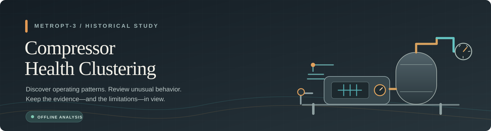
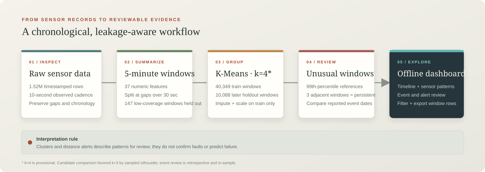

<p align="center">
  
</p>

<p align="center">
  
  
  
  
</p>

<p align="center"><b>Turn historical compressor sensor readings into reviewable operating patterns.</b><br>MetroPT-3 · five-minute windows · unsupervised clustering</p>

> **Research prototype.** The saved k=4 model groups operating behavior. It is not a validated fault detector, health score, or failure predictor.

<p align="center">
  <a href="Project_Goal.md">Project goal</a> ·
  <a href="Model.md">Model notes</a> ·
  <a href="#run-the-dashboard">Open dashboard</a> ·
  <a href="#reproduce-the-notebooks">Reproduce analysis</a>
</p>

## The workflow

<p align="center"></p>

Raw sensor records are checked and split at long timestamp gaps. Notebook 02 turns continuous periods into five-minute summaries; notebook 03 fits the clustering pipeline on the earlier data; notebook 04 reviews distances and reported events. The dashboard reads the saved outputs.

## Project snapshot

| **1,516,948** | **15** | **50,584** | **4 (provisional)** |
|:---:|:---:|:---:|:---:|
| raw sensor rows | signals | five-minute windows | saved clusters |

| What the current analysis says | What it does **not** say |
|---|---|
| Most windows share one broad pattern; cluster frequencies shift substantially in the later holdout period. | Cluster numbers do not mean healthy, faulty, or severe. |
| 484 individual distance alerts were flagged; 7 windows were in runs meeting the persistence rule. | The flags are not validated alarms or predicted failures. |
| Candidate silhouette favored k=3 (0.9429) over saved k=4 (0.9375). | The saved k=4 choice is provisional; the score alone cannot pick an operational model. |

The four documented events all occur in the training period. Their comparison is retrospective and in-sample, not independent validation. See [Model.md](Model.md) for metrics and caveats.

## Data at a glance

The project uses the [UCI MetroPT-3 dataset](https://archive.ics.uci.edu/dataset/791/metropt%2B3%2B). The source description says 1 Hz, while the supplied CSV has a median observed interval of about **10 seconds**. There are **331 gaps longer than 30 seconds**, which are kept separate rather than interpolated across. The raw files remain under `data/raw/`.

Each model row represents a **five-minute window** with 37 numeric features: summaries of seven analog signals, fractions for eight digital states, and a state-transition count. Windows below the 80% coverage threshold remain available in metadata but are not assigned to a cluster.

## Run the dashboard

The Streamlit app is an **offline viewer** for files already saved under `data/processed/` and `models/`. It includes a timeline, cluster mix, sensor trends, event context, unusual-window review, filters, and CSV export.

```powershell
.\.venv\Scripts\Activate.ps1
streamlit run app.py
```

Open the local URL printed in the terminal. Stop any old server with **Ctrl+C** before restarting after app changes.

### Run with Docker

Build the dashboard image from the project root, then start it:

```powershell
docker build -t compressor-health-dashboard .
docker run --rm -p 8501:8501 compressor-health-dashboard
```

Open [http://localhost:8501](http://localhost:8501). The image includes the saved dashboard inputs and model metadata; it does not include raw data or notebooks and does not train the model.

## Reproduce the notebooks

Select `.venv` as the notebook kernel, then run each notebook top to bottom and save its output before moving on:

1. `notebooks/01_data_understanding.ipynb`
2. `notebooks/02_feature_engineering.ipynb`
3. `notebooks/03_kmeans_clustering.ipynb`
4. `notebooks/04_condition_monitoring.ipynb`

The saved model is built from training data only. The latest 20% of eligible windows are assigned as a chronological holdout without refitting preprocessing or K-Means.

## Repository map

| Location | Open this for |
|---|---|
| `data/raw/` | Original CSV and dataset description |
| `data/processed/` | Window features, metadata, assignments, and monitoring summaries |
| `notebooks/` | Four-step analysis workflow |
| `models/` | Fitted pipeline and model metadata |
| `reports/` | Generated figures and reports |
| `app.py` | Offline Streamlit dashboard |
| `Dockerfile` | Local Docker image for the dashboard |
| `requirements-docker.txt` | Minimal dashboard-container dependencies |
| `.dockerignore` | Keeps raw data and development files out of the Docker build context |
| `docs/assets/` | Project banner and pipeline illustrations |
| `Model.md` | Model method, results, artifacts, and interpretation limits |
| `Project_Goal.md` | Aim, scope, success criteria, limitations, and next steps |

## Project documents

- [Project goal](Project_Goal.md) — what the project is intended to answer and what evidence is still needed.
- [Model details](Model.md) — feature design, preprocessing, evaluation, saved findings, and artifact inventory.

## Important limitations

- The observed cadence conflicts with the source description; there are also long gaps and coarse event annotations.
- All four reported events fall within training, so event overlap cannot establish prospective warning performance.
- k=4 is provisional, k=3 scored higher on candidate silhouette, and two k=4 profiles are nearly indistinguishable.
- Distance thresholds are exploratory references. The data have no row-level verified fault labels.
- The history covers one compressor and one period. The dashboard is historical and does not connect to live equipment.

For the full scope and next validation priorities, see [Project_Goal.md](Project_Goal.md).
